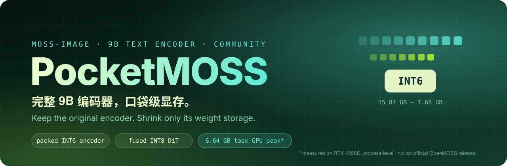
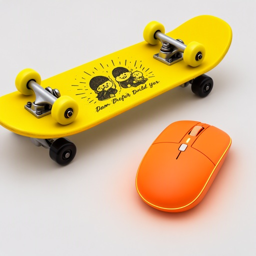
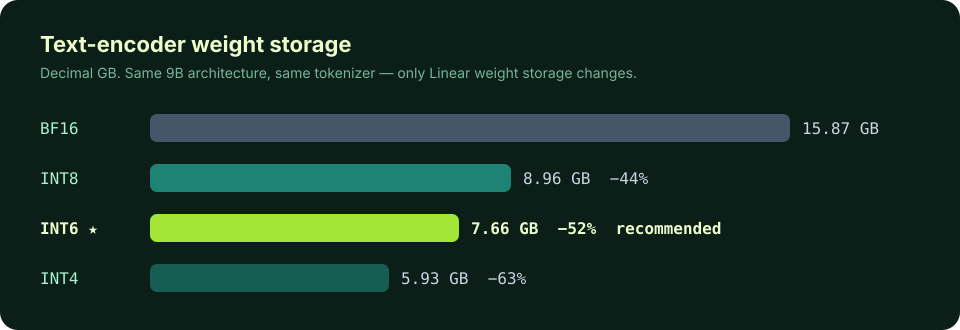
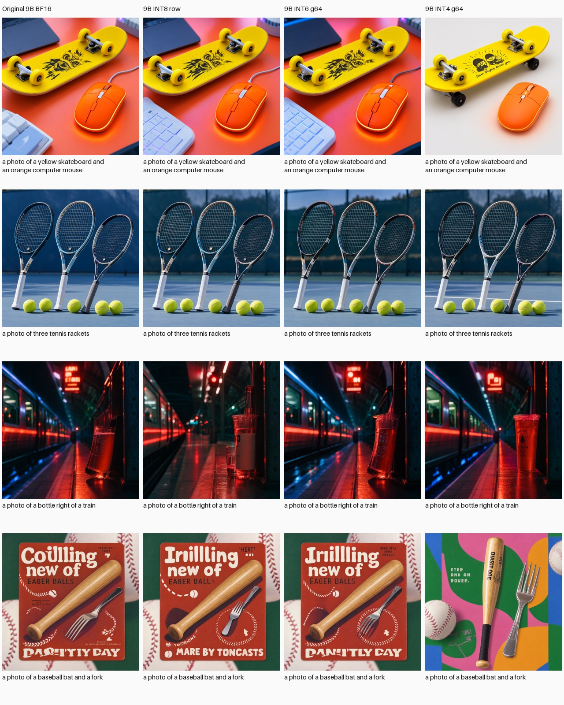
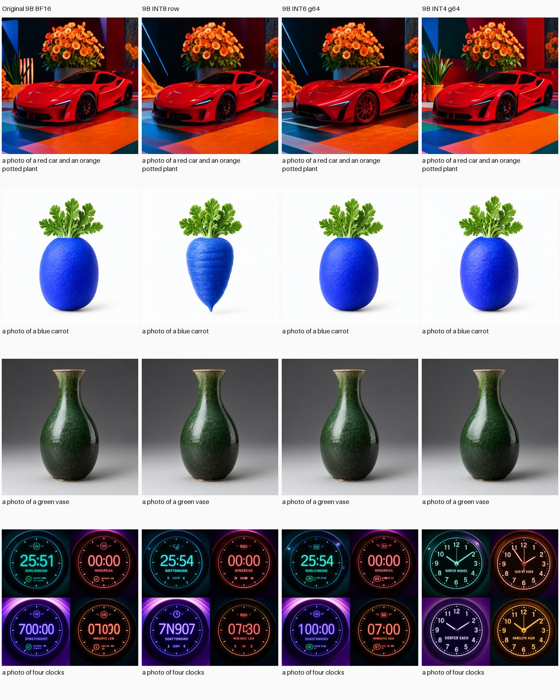

<div align="center">



<br>

[](https://github.com/QinXi-ai/pocket-moss-image/actions/workflows/tests.yml)


[](LICENSE)
[](https://huggingface.co/OpenMOSS-Team/MOSS-Image-SFT)

**[✨ Comparison](#-see-the-difference)** ·
**[🚀 Quick start](#-quick-start)** ·
**[🧠 How it works](#-how-it-works)** ·
**[📊 Results](#-measured-results)** ·
**[🖼️ Gallery](#️-full-gallery)**

</div>

---

> **No smaller replacement model. No projection network. No retraining.**
> Pocket MOSS Image keeps MOSS-Image's original **9B text encoder**, tokenizer, prompt template and conditioning intact. It **genuinely packs the encoder's Linear weights to 6 bits** and pairs them with a **streamed, fused INT8 DiT**. Same model, much smaller memory footprint.

Pocket MOSS Image (formerly *MOSS Mini*) is a community inference project for [MOSS-Image](https://github.com/OpenMOSS/MOSS-Image). INT6 is the default; INT8 and INT4 are one flag away.

<table>
<tr>
<td align="center" width="25%"><h3>9B</h3><sub>original encoder,<br>kept intact</sub></td>
<td align="center" width="25%"><h3>−52%</h3><sub>encoder weights<br>15.87 → 7.66 GB (INT6)</sub></td>
<td align="center" width="25%"><h3>6.64 GB</h3><sub>full-workflow<br>task GPU peak*</sub></td>
<td align="center" width="25%"><h3>0</h3><sub>extra training<br>or adapters</sub></td>
</tr>
</table>

<sub>* Process-level measurement of the full INT6 workflow over 12 development prompts on an RTX 4090D (24 GiB); process-tree RSS peak 9.60 GB. **Not yet validated on a physical 8 GB GPU or a 16 GB host.** Whole-card usage also includes the driver and other processes. See [results and limits](docs/results.md).</sub>

## ✨ See the difference

Same prompt, same noise, same fused INT8 DiT. **Only the text encoder's weight precision changes.**

<table>
<tr>
<th align="center">Original BF16</th>
<th align="center">INT8</th>
<th align="center">⭐ INT6 · default</th>
<th align="center">INT4</th>
</tr>
<tr>
<td></td>
<td></td>
<td></td>
<td></td>
</tr>
<tr><td colspan="4" align="center"><sub><i>a photo of a yellow skateboard and an orange computer mouse</i></sub></td></tr>
<tr>
<td></td>
<td></td>
<td></td>
<td></td>
</tr>
<tr><td colspan="4" align="center"><sub><i>a photo of three tennis rackets</i></sub></td></tr>
</table>

<p align="center">

</p>

> [!NOTE]
> The INT6 recommendation reflects visual preference and the resource tradeoff on 12 reused development prompts. It is not a measured, universal quality win, and the original BF16 outputs make mistakes too.

## 🚀 Quick start

**Tested runtime:** Linux · Python 3.12 · NVIDIA CUDA · PyTorch 2.9.1+cu128. The fused backend is pinned to OrbitQuant 0.14.0 and Comfy Kitchen 0.2.37. Windows and other GPU architectures are not validated. Use a driver compatible with the required CUDA libraries.

```bash
git clone https://github.com/QinXi-ai/pocket-moss-image.git
cd pocket-moss-image
python3.12 -m venv .venv && source .venv/bin/activate
python -m pip install --upgrade pip
python -m pip install torch==2.9.1 --index-url https://download.pytorch.org/whl/cu128
python -m pip install -e '.[dev]'
python -m pytest -q
```

> [!TIP]
> The Python package and CLI keep the name **`moss-mini`**, so existing scripts continue to work.

### 1 · Generate with INT6

```bash
CUDA_VISIBLE_DEVICES=0 moss-mini generate \
  --prompt 'a photo of a yellow skateboard and an orange computer mouse' \
  --output outputs/skateboard
```

Output: `outputs/skateboard/image.png`, saved conditions/noise, and JSON completion records. Each run needs a new output directory.

The default model is [`OpenMOSS-Team/MOSS-Image-SFT`](https://huggingface.co/OpenMOSS-Team/MOSS-Image-SFT), pinned to revision `797fa8e678b4f0a766271bf5103e6cd7a2faa999`. The first run downloads the original weights and pipeline code from Hugging Face, so allow **tens of GB** of disk space. Pipeline code is executed from this pinned snapshot.

### 2 · Pack once, reuse

Skip repeating CPU quantization on every run:

```bash
CUDA_VISIBLE_DEVICES=0 moss-mini pack --bits 6 --output packed-int6
CUDA_VISIBLE_DEVICES=0 moss-mini generate \
  --packed packed-int6/encoder \
  --prompt 'a photo of a yellow skateboard and an orange computer mouse' \
  --output outputs/skateboard-packed
```

Packing also needs a CUDA GPU in this release. The packed INT6 encoder holds 7.66 GB of tensor state; leave extra room for metadata and the original model. The manifest is relocatable and binds model identity, configuration and quantization recipe. Do not reuse an artifact with different weights or tokenizer files.

### 3 · Pick a precision

| Option | CPU-offloaded leading layers | Best for |
|---|:---:|---|
| `--bits 6` ⭐ | 20 | Recommended visual / storage compromise |
| `--bits 8` | 16 | Higher-precision reference |
| `--bits 4` | 12 | Smallest encoder state; larger visual changes on some prompts |

The embedding is always offloaded to CPU. Override with `--offload-layers N` only if you can measure your own resource envelope: more GPU placement lowers RAM but raises VRAM. The default INT6 and INT4 placements survived a synthetic 256-token encoder stress test; longer contexts, larger batches or other resolutions are not claimed to fit the same budget.

<details>
<summary><b>Use an existing local snapshot</b></summary>

```bash
moss-mini generate --model /path/to/MOSS-Image-SFT \
  --source-version sft-797fa8e678b4 \
  --prompt 'a photo of three tennis rackets' --output outputs/rackets
```

Use the same `--model` and `--source-version` for packing and generation. A local identity is caller-declared: change the version whenever weights, tokenizer or pipeline code change. It does not cryptographically verify content. Original snapshots remain necessary for tokenizer/configuration and generator weights; packed artifacts are not standalone model distributions.

</details>

<details>
<summary><b>Defaults & CUDA notes</b></summary>

- **Defaults:** 1024×1024, 50 steps, seed 42, CFG 3, shift 5, unconditional skip layer 22, at most 256 text tokens, batch size 1, SDPA attention, four CPU threads. Long prompts are truncated by the original tokenizer. Thread limits reduce CPU parallelism; they are not a CPU-utilization guarantee.
- **cuBLAS:** the CLI locates the installed `nvidia-cublas` CUDA 13 library directory and exposes it to its subprocesses. Comfy Kitchen's cuBLASLt INT8 backend needs it; it does not replace PyTorch's CUDA 12.8 runtime. No ComfyUI installation is required.

</details>

## 🧠 How it works


- **Two separate processes.** The encoder process exits before the generator starts, so their peaks never stack.
- **Quantized storage only.** 248 standard Linear modules are genuinely packed to 6 or 4 bits using symmetric absmax in groups of 64 input columns with FP32 scales; all other state stays BF16. Each Linear temporarily reconstructs a BF16 matrix for its GEMM. **INT6 refers to weight storage, not a fused INT6 compute kernel.**
- **Streamed DiT.** The DiT uses fused W8A8 computation and model CPU offload; source DiT tensors are loaded one block at a time.
- **Reproducible.** Across all 12 development prompts, streamed INT8 matched the prior INT8 loader exactly in conditions, masks and PNG pixels, and prepacked INT6/INT4 matched their on-the-fly recipes exactly. This is *within-recipe loading equivalence*, not equivalence to BF16.

## 📊 Measured results

RTX 4090D (24 GiB), 12 development images, decimal GB, task-process NVML usage plus sampled process-tree RSS.

| Encoder | CPU layers | Encoder state | Workflow GPU peak | Tree RSS peak | 12-image runtime |
|---|:---:|---:|---:|---:|---:|
| INT8 row | 16 | 8.96 GB | 6.41 GB | 9.59 GB | 371 s |
| **INT6 g64, prepacked ⭐** | **20** | **7.66 GB** | **6.64 GB** | **9.60 GB** | **322 s** |
| INT4 g64, prepacked | 12 | 5.93 GB | 6.41 GB | 9.51 GB | 331 s |

Runtimes are descriptive, not a controlled throughput comparison. For the full protocol, the **failed configurations kept on record**, and the 256-token stress test, see:

📄 [Results & limits](docs/results.md) · 📈 [Portable metrics](docs/metrics.json) · ✅ [Release validation](docs/validation.md)

No model weights, development caches or private server configuration are included. An earlier 4B replacement encoder did not recover the desired visual behavior in our experiments, which is why this project keeps the original 9B and quantizes it instead.

## 🖼️ Full gallery

Columns, left to right: **BF16 → INT8 → INT6 → INT4**. These are JPEG previews of actual generated images. They illustrate differences, not a blinded ranking or a held-out benchmark.

<details>
<summary><b>Expand all 12 comparisons</b></summary>
<br>

<p align="center"></p>
<p align="center"></p>
<p align="center"></p>

An interactive table is also available in [`docs/comparison/index.html`](docs/comparison/index.html) (download and open locally).

</details>

## 🙏 Credits & license

Code is released under **Apache-2.0**; see [LICENSE](LICENSE) and [NOTICE](NOTICE).

Built on [OpenMOSS/MOSS-Image](https://github.com/OpenMOSS/MOSS-Image), [OrbitQuant](https://pypi.org/project/orbitquant/), [Comfy Kitchen](https://pypi.org/project/comfy-kitchen/), Diffusers, Transformers and Accelerate. Model weights and downloaded pipeline code retain their upstream licenses. Generated previews are provided for comparison; the code license does not grant rights to third-party marks or model weights.

<div align="center">
<br>
<sub>Pocket MOSS Image is an independent community project and <b>not an official OpenMOSS release</b>.</sub>
<br>
<sub>If it saved you some VRAM, a ⭐ helps others find it.</sub>
</div>
