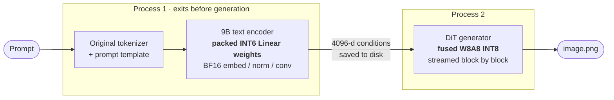

<div align="center">


<br>

[](https://github.com/QinXi-ai/pocket-moss/actions/workflows/tests.yml)


[](LICENSE)
[](https://huggingface.co/OpenMOSS-Team/MOSS-Image-SFT)

**[✨ 效果对比](#-效果对比--see-the-difference)** ·
**[🚀 快速开始](#-快速开始--quick-start)** ·
**[🧠 原理](#-工作原理--how-it-works)** ·
**[📊 实测数据](#-实测数据--measured)** ·
**[🖼️ 全部样例](#️-全部-12-组样例--full-gallery)**

</div>

---

> **不换小模型，不加投影网络，不重新训练。**
> PocketMOSS 保留 MOSS-Image 原始 **9B 文本编码器**、tokenizer、提示模板与条件表示，只把它的 Linear 权重**真正打包到 6 bit**，再配合 **fused INT8 DiT** 流式推理——同一套模型，显存占用大幅下降。

PocketMOSS (formerly *MOSS Mini*) is a community inference project for [MOSS-Image](https://github.com/OpenMOSS/MOSS-Image). It keeps the original 9B encoder intact and shrinks only its weight storage. INT6 is the default; INT8 and INT4 are one flag away.

<table>
<tr>
<td align="center" width="25%"><h3>9B</h3><sub>原始编码器完整保留<br>original encoder, untouched</sub></td>
<td align="center" width="25%"><h3>−52%</h3><sub>编码器权重 15.87 → 7.66 GB<br>packed INT6 storage</sub></td>
<td align="center" width="25%"><h3>6.64 GB</h3><sub>完整流程任务显存峰值*<br>task-process GPU peak</sub></td>
<td align="center" width="25%"><h3>0</h3><sub>额外训练 / 投影网络<br>training or adapters</sub></td>
</tr>
</table>

<sub>* RTX 4090D（24 GiB）上 12 条开发提示、INT6 完整流程的进程级测量；进程树内存峰值 9.60 GB。**尚未在物理 8GB 显卡 / 16GB 主机上验证**，整卡占用还包含驱动和其他进程。详见 [实测数据与限制](docs/results.md)。</sub>

## ✨ 效果对比 · See the difference

相同提示、相同噪声、相同 fused INT8 DiT，**只改变文本编码器的权重精度**：

<table>
<tr>
<th align="center">Original BF16</th>
<th align="center">INT8</th>
<th align="center">⭐ INT6 · default</th>
<th align="center">INT4</th>
</tr>
<tr>
<td></td>
<td></td>
<td></td>
<td></td>
</tr>
<tr><td colspan="4" align="center"><sub><i>a photo of a yellow skateboard and an orange computer mouse</i></sub></td></tr>
<tr>
<td></td>
<td></td>
<td></td>
<td></td>
</tr>
<tr><td colspan="4" align="center"><sub><i>a photo of three tennis rackets</i></sub></td></tr>
</table>

<p align="center">

</p>

> [!NOTE]
> 推荐 INT6 是基于 12 条复用开发提示的**视觉偏好**与资源权衡，不是可推广的质量优势结论；原始 BF16 输出本身也会出错。The INT6 recommendation reflects visual preference on 12 development prompts, not a measured universal quality win.

## 🚀 快速开始 · Quick start

**Tested runtime:** Linux · Python 3.12 · NVIDIA CUDA · PyTorch 2.9.1+cu128. The fused backend is pinned to OrbitQuant 0.14.0 and Comfy Kitchen 0.2.37. Windows and other GPU architectures are not validated. Use a driver compatible with the required CUDA libraries.

```bash
git clone https://github.com/QinXi-ai/pocket-moss.git
cd pocket-moss
python3.12 -m venv .venv && source .venv/bin/activate
python -m pip install --upgrade pip
python -m pip install torch==2.9.1 --index-url https://download.pytorch.org/whl/cu128
python -m pip install -e '.[dev]'
python -m pytest -q
```

> [!TIP]
> The Python package and CLI keep the name **`moss-mini`**, so existing scripts continue to work.

### 1 · 生成一张图 · Generate with INT6

```bash
CUDA_VISIBLE_DEVICES=0 moss-mini generate \
  --prompt 'a photo of a yellow skateboard and an orange computer mouse' \
  --output outputs/skateboard
```

Output: `outputs/skateboard/image.png`, saved conditions/noise, and JSON completion records. Each run needs a new output directory.

The default model is [`OpenMOSS-Team/MOSS-Image-SFT`](https://huggingface.co/OpenMOSS-Team/MOSS-Image-SFT), pinned to revision `797fa8e678b4f0a766271bf5103e6cd7a2faa999`. The first run downloads the original weights and pipeline code from Hugging Face — allow **tens of GB** of disk. Pipeline code is executed from this pinned snapshot.

### 2 · 打包一次，反复使用 · Pack once, reuse

Skip repeating CPU quantization on every run:

```bash
CUDA_VISIBLE_DEVICES=0 moss-mini pack --bits 6 --output packed-int6
CUDA_VISIBLE_DEVICES=0 moss-mini generate \
  --packed packed-int6/encoder \
  --prompt 'a photo of a yellow skateboard and an orange computer mouse' \
  --output outputs/skateboard-packed
```

Packing also needs a CUDA GPU in this release. The packed INT6 encoder holds 7.66 GB of tensor state; leave extra room for metadata and the original model. The manifest is relocatable and binds model identity, configuration and quantization recipe — do not reuse an artifact with different weights or tokenizer files.

### 3 · 选择精度 · Pick a precision

| Option | CPU-offloaded leading layers | Best for |
|---|:---:|---|
| `--bits 6` ⭐ | 20 | Recommended visual / storage compromise |
| `--bits 8` | 16 | Higher-precision reference |
| `--bits 4` | 12 | Smallest encoder state; larger visual changes on some prompts |

The embedding is always offloaded to CPU. Override with `--offload-layers N` only if you can measure your own resource envelope — more GPU placement lowers RAM but raises VRAM. The default INT6 and INT4 placements survived a synthetic 256-token encoder stress test; longer contexts, larger batches or other resolutions are not claimed to fit the same budget.

<details>
<summary><b>使用已有的本地模型快照 · Use an existing local snapshot</b></summary>

```bash
moss-mini generate --model /path/to/MOSS-Image-SFT \
  --source-version sft-797fa8e678b4 \
  --prompt 'a photo of three tennis rackets' --output outputs/rackets
```

Use the same `--model` and `--source-version` for packing and generation. A local identity is caller-declared: change the version whenever weights, tokenizer or pipeline code change. It does not cryptographically verify content. Original snapshots remain necessary for tokenizer/configuration and generator weights; packed artifacts are not standalone model distributions.

</details>

<details>
<summary><b>默认参数与 CUDA 库说明 · Defaults & CUDA notes</b></summary>

- **Defaults:** 1024×1024, 50 steps, seed 42, CFG 3, shift 5, unconditional skip layer 22, at most 256 text tokens, batch size 1, SDPA attention, four CPU threads. Long prompts are truncated by the original tokenizer. Thread limits reduce CPU parallelism; they are not a CPU-utilization guarantee.
- **cuBLAS:** the CLI locates the installed `nvidia-cublas` CUDA 13 library directory and exposes it to its subprocesses. Comfy Kitchen's cuBLASLt INT8 backend needs it; it does not replace PyTorch's CUDA 12.8 runtime. No ComfyUI installation is required.

</details>

## 🧠 工作原理 · How it works



- **两段式进程：** 编码器进程先退出，生成器再启动，两者的峰值不会叠加。
- **只量化存储：** 248 个标准 Linear 以 64 列分组、对称 absmax 真正打包为 6/4 bit（FP32 scale），其余状态保持 BF16。每个 Linear 在 GEMM 前临时重建 BF16 矩阵——**INT6 指的是权重存储，而不是 fused INT6 计算核。**
- **流式 DiT：** DiT 使用 fused W8A8 计算与模型 CPU offload，源权重逐个 block 加载。
- **可复现：** 流式 INT8 与先前 INT8 加载器在 12 条提示上条件、mask 与 PNG 像素完全一致；预打包 INT6/INT4 与各自的即时量化方案同样完全一致（这是**同方案加载等价**，不是与 BF16 等价）。

## 📊 实测数据 · Measured

RTX 4090D (24 GiB), 12 development images, decimal GB, task-process NVML + sampled process-tree RSS.

| Encoder | CPU layers | Encoder state | Workflow GPU peak | Tree RSS peak | 12-image runtime |
|---|:---:|---:|---:|---:|---:|
| INT8 row | 16 | 8.96 GB | 6.41 GB | 9.59 GB | 371 s |
| **INT6 g64, prepacked ⭐** | **20** | **7.66 GB** | **6.64 GB** | **9.60 GB** | **322 s** |
| INT4 g64, prepacked | 12 | 5.93 GB | 6.41 GB | 9.51 GB | 331 s |

Runtimes are descriptive, not a controlled throughput comparison. For the full protocol, the **failed configurations we kept on record**, and the 256-token stress test, see:

📄 [Results & limits](docs/results.md) · 📈 [Portable metrics](docs/metrics.json) · ✅ [Release validation](docs/validation.md)

No model weights, development caches or private server configuration are included. An earlier 4B replacement encoder did not recover the desired visual behavior in our experiments — which is exactly why PocketMOSS keeps the original 9B and quantizes it instead.

## 🖼️ 全部 12 组样例 · Full gallery

Columns, left to right: **BF16 → INT8 → INT6 → INT4**. JPEG previews of actual generated images — they illustrate differences, not a blinded ranking or held-out benchmark.

<details>
<summary><b>展开全部对比 · Expand all comparisons</b></summary>
<br>

<p align="center"></p>
<p align="center"></p>
<p align="center"></p>

An interactive table is also available in [`docs/comparison/index.html`](docs/comparison/index.html) (download and open locally).

</details>

## 🙏 致谢与许可 · Credits & license

Code is released under **Apache-2.0** — see [LICENSE](LICENSE) and [NOTICE](NOTICE).

Built on [OpenMOSS/MOSS-Image](https://github.com/OpenMOSS/MOSS-Image), [OrbitQuant](https://pypi.org/project/orbitquant/), [Comfy Kitchen](https://pypi.org/project/comfy-kitchen/), Diffusers, Transformers and Accelerate. Model weights and downloaded pipeline code retain their upstream licenses. Generated previews are provided for comparison; the code license does not grant rights to third-party marks or model weights.

<div align="center">
<br>
<sub>PocketMOSS is an independent community project and <b>not an official OpenMOSS release</b>.</sub>
<br>
<sub>If it saved you some VRAM, a ⭐ helps others find it.</sub>
</div>
