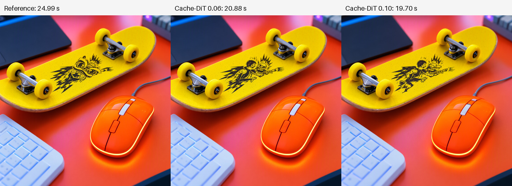

# Execution acceleration experiments

These options preserve the original 9B encoder and existing INT6/W8A8 weight
recipes. Exact preprocessing reuse and CPU embedding lookup are separate from
approximate Cache-DiT reuse. All remain explicit CLI options. Measurements use
RTX 4090D 24GiB, four CPU threads, batch one, 1024×1024 and 50 steps. GB is decimal.
They do not establish execution on a physical 8GB GPU or 16GB host.

[Machine-readable receipts](acceleration-metrics.json) retain all reported
probes, including the no-hit Cache-DiT configuration and unhelpful compiler run.
[Separate tensor and pixel comparisons](acceleration-tensor-comparison.json)
verify the integrated CLI conditions, initial noise and decoded images.

## Integrated CLI results

The short-prompt commands include the parent process, all subprocesses, imports,
loading, encoding when requested, generation and output writing. Both reference
and exact runs use packed encoder and DiT artifacts.

| Complete command | Seconds | Task GPU peak GB | Tree RSS peak GB | PNG vs reference |
|---|---:|---:|---:|---|
| Packed reference, original offload 20 | 51.219 | 6.637 | 8.503 | reference |
| CPU lookup, offload 0, exact request cache | 48.321 | 6.598 | 7.361 | exact |
| Reuse conditions, request cache, Cache-DiT 0.06 | 33.951 | 6.585 | 7.378 | changed |

The exact pair took **5.7% less time** and reduced the sampled full-command RAM
peak by about **1.14GB**. The approximate row also skips encoder loading through
saved conditions, so its entire improvement must not be attributed to Cache-DiT.
Each row is one run, in table order, with warm caches on a shared host; these are
bounded observations, not a general speed guarantee.

For a separate synthetic 256-token condition replay, exact request caching
preserved image pixels: 39.404→38.875 seconds whole command and
26.923→26.538 seconds denoise/decode/save. Both used 6.497GB task VRAM and about
7.35GB sampled RSS. This is a context-length performance/equivalence witness,
not a natural-language quality test.

## CPU lookup and GPU-resident encoder layers

Accelerate's original CPU weight offload executes embedding lookup on CUDA:
it transfers the 248,320×4,096 BF16 vocabulary (2,034,237,440 bytes) before each
forward. `--embedding-lookup cpu` changes only that hook: the exact table stays
on CPU, and the selected rows return to the input IDs' device. The 21-token
positive prompt transfers 172,032 output bytes; 256 tokens transfer 2,097,152.

Freed VRAM permits more packed encoder layers to remain on CUDA. At zero
offloaded layers, all 32 layers stay on GPU while the vocabulary stays on CPU.

| Encoder probe | Original lookup, offload 20 | CPU lookup, offload 20 | CPU lookup, offload 0 |
|---|---:|---:|---:|
| Positive + negative encoding | 2.795 s | 4.227 s | 1.074 s |
| Synthetic 256-token forward | 1.060 s | 1.669 s | 0.305 s |
| Sampled task GPU peak | 6.637 GB | 3.051 GB | 6.598 GB |
| Sampled tree RSS peak | 8.453 GB | 8.347 GB | 4.911 GB |

Each column is one complete process with loading, two natural-language forwards
and one deterministic synthetic 256-token forward. Short conditions and synthetic
outputs match exactly. Instrumentation inside the actual embedding forward
confirms the table executes on CPU, rather than inferring placement from its
between-forward meta state. CPU lookup alone was slower; the benefit comes from
using the released VRAM to reduce layer offload. These are encoder measurements,
not complete image-generation memory peaks or quality scores.

## Exact request cache

`--request-cache` caches binary-mask validation, compacted context, RoPE, expanded
Orbit RoPE tables and the two-block text projection. None depends on diffusion
timestep. Positive/negative conditions stay separate, with tensor identity and
version, dtype, device, shapes, model state and autocast tracked. The cache is
bounded to two entries per stage and 32MiB total; it is cleared on model movement
and request exit, including exit caused by errors. It does not support concurrent requests or untracked
`.data`/external-storage mutations. Grad-enabled or unversioned tensors bypass
reuse. It preserves the pinned upstream math through narrowly checked source
patterns and refuses a source mismatch.

For the short prompt, mask/context/RoPE/text each had **98 hits and 2 misses** in
100 transformer calls. Peak cached tensor accounting was 13.07MB, zero at exit.
PNG pixels matched the uncached baseline. Denoise/decode was 24.940 vs 24.816
seconds in a matched pair: a small gain for a short prompt, not a large speedup.
The earlier text-projection-only implementation likewise preserved pixels but
saved only about 0.2 seconds. Repeated work removed is not itself a latency claim.

## Cache-DiT: approximate block reuse

The adapter uses Cache-DiT **1.5.3**, a public custom `BlockAdapter` with the
single-stream `Pattern_3`. The first 8 and last 2 active blocks are computed,
with residual reuse for the middle blocks when the threshold permits. Each
condition identity and skip-layer set receives an independent context. This
preserves MOSS's unconditional skip-layer-22 behavior; directly collapsing its
original layer list would break those indices. Warmup is 8 steps, and at most
one consecutive step is cached. Original block forwards are shared unchanged.

| Short-prompt probe | Denoise + decode | Full benchmark process | Hits / branch calls | PSNR vs reference |
|---|---:|---:|---:|---:|
| Reference | 24.991 s | 35.250 s | — | exact |
| Threshold 0 | 25.009 s | 35.308 s | 0 / 100 | exact |
| Threshold 0.03 | 25.094 s | 35.455 s | 0 / 100 | exact |
| Threshold 0.06 + text projection cache | 20.876 s | 31.586 s | 30 / 100 | 27.87 dB |
| Threshold 0.10 + text projection cache | 19.704 s | 30.399 s | 40 / 100 | 26.34 dB |

These benchmark processes load a packed DiT and previously saved conditions;
they do not encode a new prompt. Do not compare their process timings directly
to a complete encode-and-generate CLI command. All use the same prompt, seed and
initial noise. Threshold 0 verified adapter replay equivalence. Nonzero-threshold
outputs change: the skateboard graphic and, at 0.10, mouse details differ.
PSNR measures pixel deviation, not semantic fidelity or image quality. This is
one reused development prompt, not a held-out benchmark. Cache-DiT task GPU peak
was 6.585GB, versus 6.407GB for the generator reference. All tested runs stayed
below decimal 8GB task VRAM and 16GB sampled tree RSS; whole-device usage includes
additional driver/other activity and exceeded 8GB.

The extended exact request cache combined with threshold 0.06 produced the same
pixels as the projection-only/0.06 case, with 20.498 seconds denoise/decode and
31.464 seconds for the benchmark process. These individual timings are subject
to disk/compiler caches and shared-host variation.

JPEG previews of actual outputs; labels show denoise/decode time, not full CLI
latency. Note the changing skateboard graphic.

## TorchInductor probe

A real first-step positive-condition joint block compiled into one graph with
99 captured operations and no graph breaks. Warm median was 4.352→4.300ms in
the first probe; a repeat was 4.353→4.381ms. The first compile call took 22.94s.
Output was finite but not exact (relative L2 0.00366); repeat eager and compiled
outputs were individually stable. The largest BF16 difference was 128 on a
reference element of magnitude 16,384. There is no demonstrated whole-image
speed or fidelity benefit, so this compile path is not exposed as a CLI option.
TensorRT and vLLM/SGLang were not integrated or claimed as tested.

## Validation and remaining opportunities

The integrated CPU suite passed 76 tests with 3 CUDA tests skipped, including
real Cache-DiT contexts and Accelerate hooks. GPU probes cover zero-threshold
replay, CFG separation, exact request reuse, short/256-token encoder equality
and CPU embedding execution. Resource measurements sample the entire process
tree; they may miss short peaks and RSS sums include shared pages.

The source scan also identified same-step CFG duplication of video/time
projection, repeated residual clones, and activation-quantization intermediates.
These are candidates, not implemented speedups. Removing residual clones would
need special care around Cache-DiT's retained tensors. No recommendation changes
are based only on estimated bytes or operator timings.
